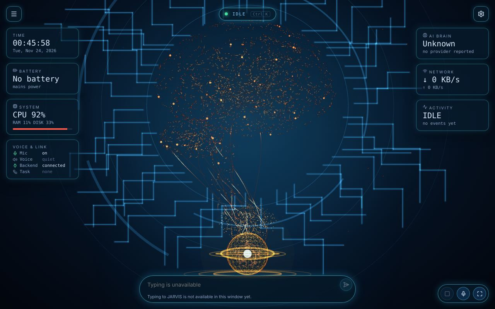
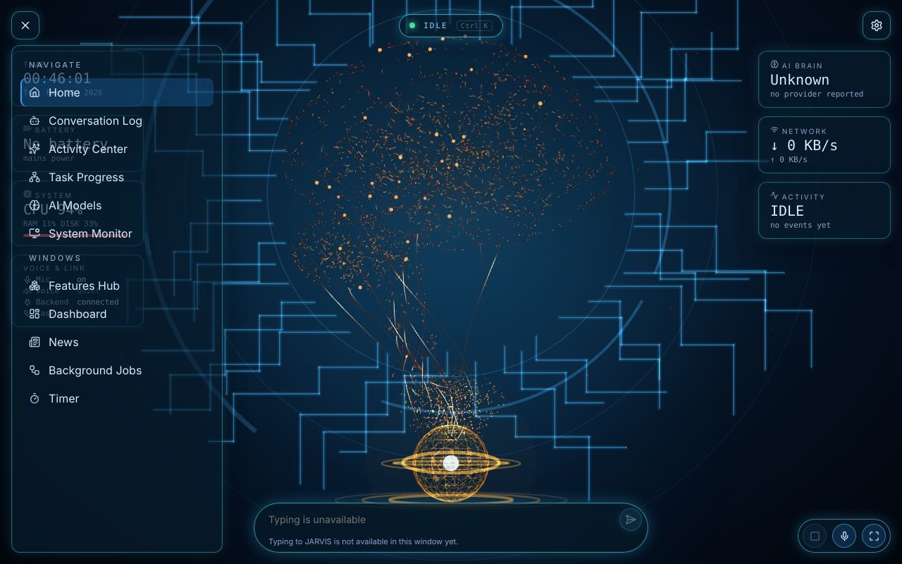
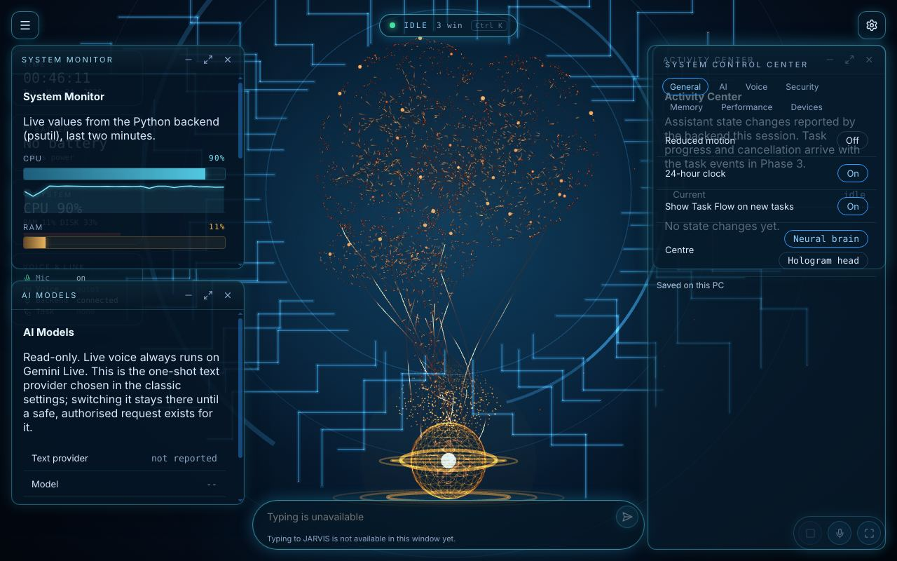
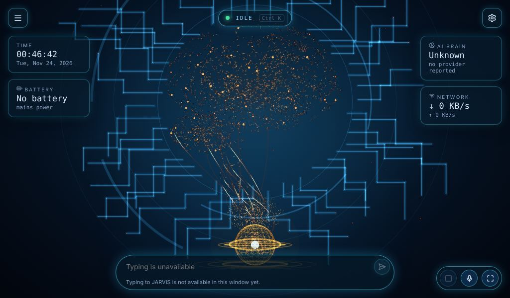
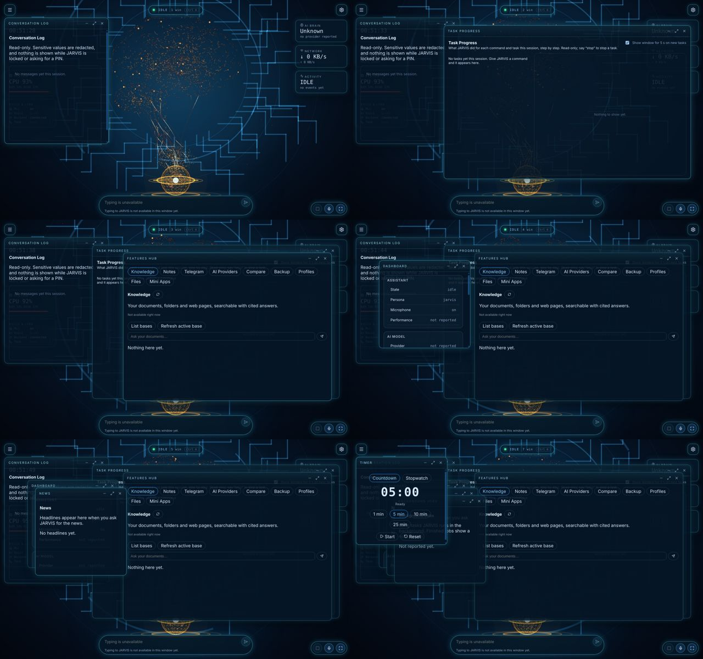

# UI audit — Phase 0 (2026-11-24)

Master prompt "UI/UX Upgrade Agent", Phase 0. No code changed. `main` after #325.

**Product:** JARVIS AI Pro — a personal voice assistant for the owner's Windows laptop, tablet and phone.
**Surfaces:** Web UI (React 19 + Three.js r187 via React Three Fiber + custom GLSL, Motion for animation,
Vite 8, npm) inside a **PyQt6** QWebEngineView. That is the default UI. The classic PyQt6 HUD (`jarvis/ui/`) is
kept as the fallback (`JARVIS_UI=legacy` and when there is no WebGL 2).

## Method and limits
- The real host (`WebUIHost`, with Python backend, QWebChannel and live psutil data) was opened off-screen at
  1280×800 and 1024×600 with **software** WebGL 2 (SwiftShader). Every nav page and window was opened by clicking it.
- Software rendering: **backdrop blur did not render and FPS isn't representative**, so readability issues look
  worse here than on a GPU. Layout, stacking, copy, sizes and contrast are representative.
- "LCP / CLS / mid-tier mobile" from the prompt don't apply: the page loads from local files inside a desktop app,
  so there is no network LCP. The tablet is only a display for the hub web client; it gets its own check in Phase 7.

## Screenshot inventory
| Main | Nav menu | Settings + 3 windows | Tablet 1024×600 |
|---|---|---|---|
|  |  |  |  |

Pages and windows (Conversation Log, Task Progress, Features Hub, Dashboard, News, Timer opened one after another):

Also covered: Command palette, System Monitor, AI Models, Activity Center, System Control Center (7 tabs),
Background Jobs, Dynamic Island, command bar, bottom dock.

## Issues
| # | Surface | Issue | Severity | WCAG | Fix phase |
|---|---|---|---|---|---|
| 1 | Web | Windows/drawers are see-through (`--glass` 0.55, panels 0.78). Without blur (software GL, lite tier, older GPUs) the text behind shows through and mixes with the text in front. | blocker | 1.4.3, 1.4.11 | P2 |
| 2 | Web | Windows pile up in the same place (cascade from top-left): 3+ windows cover the left widgets, each other and the whole hologram. | major | — | P3 |
| 3 | Web | Settings drawer is the same width as the right widgets and covers the bottom dock (stop / mic / fullscreen). | major | 2.4.11 (focus obscured) | P3 |
| 4 | Web | `--text-faint` #566b88 on glass = **3.4:1**, used for 9 kinds of text (hints, "not reported", timestamps). Too low for body text. | major | 1.4.3 | P1 |
| 5 | Web | No type scale: 11 different font sizes are written directly in the CSS, and there are no font-size tokens. | major | — | P1 |
| 6 | Web | Token drift: 79 distinct hexes and 84 distinct rgba() values in source. 32 hexes sit in CSS outside `tokens.css`, 34 in hologram TS/GLSL. 69 distinct px values; radius tokens exist but 16 radius declarations are written directly. | major | — | P1 |
| 7 | Web | Developer text visible to the owner ("…arrive with the task events in Phase 3", "…until a safe, authorised request exists"). Every window repeats its title as an H2. | major | 2.4.6 | P4 |
| 8 | Web | AI Brain widget shows "Unknown / no provider reported" although the router knows the route. | major | — | P4 |
| 9 | Web | `:focus-visible` styles: only 4 rules in app.css, none in taskflow.css (the Task Flow window has buttons). | major | 2.4.7, 2.4.13 | P5 |
| 10 | Web | Canvas: the hologram has no text alternative listing its state (only the HUD widgets have one). | minor | 1.1.1 | P5 |
| 11 | Web | The circuit backdrop is as bright behind the brain as at the edges, so the centre is busy. The orb core is a flat white dot. Stage effects running at the same time: brain particles, strands, circuit backdrop, orb rings, arcs, so more than the 2-decorative-effects budget. | minor | — | P6 |
| 12 | Web | 1024×600: three widgets are hidden with no way to reach them, and the orb touches the command bar. | minor | 1.4.10 | P7 |
| 13 | Web | Phone window planned in #318 is missing. | feature | — | P8 |
| 14 | Qt | Classic HUD: `jarvis/ui/__init__.py` has 6 718 lines with 116 `setStyleSheet` calls; `hud_main.py` has 38; 80 distinct hexes. Nothing is shared with the web tokens (only "intent" is mirrored in `core/ui_tokens.py`). | minor (fallback only) | — | P9 |
| 15 | Both | **License:** PyQt6 + PyQt6-WebEngine are GPL-3.0 (or a commercial licence) and the repo is Apache-2.0. Fine for private use; for a closed or commercial product switch to PySide6 (LGPL). Piper (optional) is also GPL-3.0. | flag | — | separate phase |
| — | Web | Command bar showed "Typing is unavailable" in the test host: expected because no `JarvisLive` session is attached. Needs a check in the real app, not a fix. | verify | — | — |

## Token drift (source counts)
| Kind | Distinct literals | Tokens defined |
|---|---|---|
| Colours (hex) | 79 (32 in CSS outside tokens, 34 in hologram code) | 14 |
| Colours (rgba) | 84 | 4 glass tokens |
| Spacing / sizes (px) | 69 | 6 space tokens |
| Radius declarations | 16 | 4 radius tokens |
| Font sizes | 11 | **0** |
| Durations | 17 | 3 duration tokens + 1 easing |
| z-index | 3 layers + windows at `20 + z` | 5 |

## Motion inventory
| Animation | Trigger | Duration | Reduced motion |
|---|---|---|---|
| `dot-blink` (status dot) | warning state | loop | yes (OS + toggle) |
| `sk-shimmer` (skeleton) | loading 1–10 s | loop | yes |
| `tf-pulse`, `tf-spin`, `tf-shine` (Task Flow nodes) | running step | loop | toggle only (`.app[data-reduced]`); **no OS media query in taskflow.css**. The toggle follows the OS setting, so it's covered when the setting is wired. |
| `tf-appear`, `tf-shrink` | node add / auto-hide timer | ~220–5000 ms | toggle |
| Motion (`motion/react`) window open/close, palette, island | user action | `--dur` 220 ms | yes (durations → 0) |
| Hologram (brain, strands, particles, orb, rings, arcs, backdrop) | always | continuous | yes: reduced look, stops when hidden |

Decorative loops can be paused by the Reduced motion toggle. There is no separate pause button for the stage (P6).

## Baselines
| Metric | Value |
|---|---|
| JS gzip (initial, all chunks eager) | app 188 kB + three 193 kB + react 84 kB = **465 kB** (raw 1.61 MB) |
| CSS gzip | 7.4 kB |
| Tests | Vitest 175 passed (31 files), tsc strict clean, oxlint clean |
| FPS | software GL only: 16–20 fps (selfcheck already marks this not representative) |
| Draw calls | not measurable without a GPU here; Phase 6 adds an on-screen counter (renderer.info) to the existing FPS overlay |
| Qt: QSS | 154 inline `setStyleSheet` calls; no .qss file; widget classes: 24 |

## Prompt items deliberately not adopted (rule 1 / rule 3 / rule 9)
- **GSAP**: not in the project; Motion already covers UI motion and R3F `useFrame` covers the stage. Adding it
  would be a second animation library.
- **Radix + shadcn**: the UI already uses cmdk (palette) and react-rnd (windows). Swapping these would rewrite
  architecture; adding Radix on top would make 3 primitive libraries. Instead, focus, roles and keyboard handling
  are fixed in our own primitives, following the WAI-ARIA patterns Radix implements.
- **Fluent Widgets for Qt**: the Qt HUD is fallback-only and the owner chose not to restyle it. P9 only generates its
  QSS colours from the same tokens; no new Qt library.

## Top 10 fixes (impact ÷ effort)
1. Readable surfaces: opaque-enough glass + solid fallback when blur is unavailable (#1)
2. Window placement in free space and no covering of the dock (#2, #3)
3. Contrast: raise `--text-faint` to ≥ 4.5:1 (#4)
4. Type scale + font-size tokens, replace the 11 literals (#5)
5. Remove developer copy and duplicate headings (#7)
6. AI Brain widget shows the real route (#8)
7. Focus-visible rings everywhere, Task Flow included (#9)
8. Colour/space/radius literals → tokens (#6)
9. Stage: centre-fade backdrop, orb core, decorative budget + pause (#11)
10. Small-screen layout for the tablet (#12)

## Phase plan (one PR each, merged when CI is green)
P1 tokens (type scale, contrast, literals → tokens) · P2 surfaces · P3 window placement and layering ·
P4 copy and live data · P5 accessibility (focus, keyboard, canvas alternative) · P6 stage and motion budget ·
P7 small screens · P8 Phone window · P9 Qt fallback QSS from tokens.
