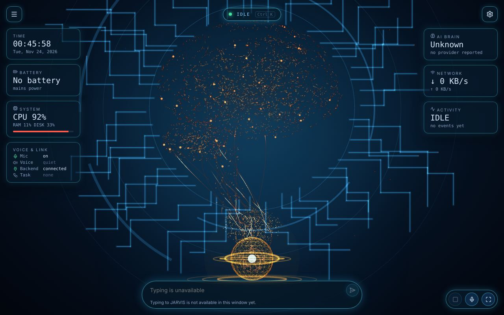
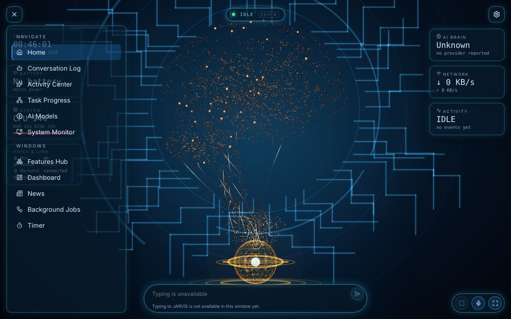
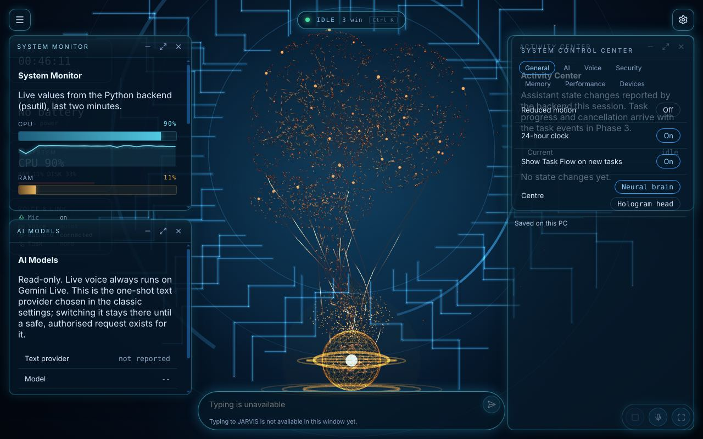
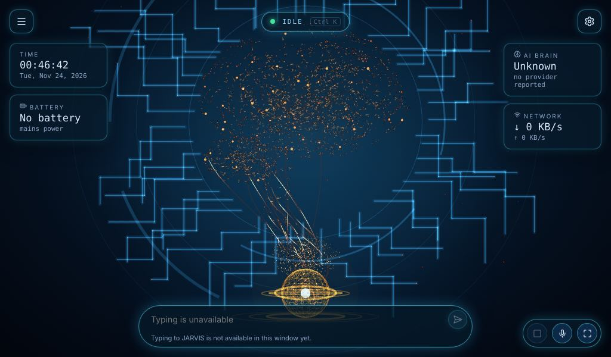

# Web UI polish — audit and plan (2026-11-24)

Status: **plan only — waiting for the owner's approval.**

## How this was audited
- `main` at the five-layer merge (#325). Frontend: `tsc` strict + Vitest **175 passed**, oxlint clean.
- The real host (`WebUIHost`, Python backend + QWebChannel + live psutil data) was opened off-screen with software
  WebGL 2 and screenshotted at **1280×800** (laptop) and **1024×600** (small tablet), then the nav menu, Settings,
  System Monitor, AI Models and Activity Center were opened by clicking their buttons.
- Software rendering, so **backdrop blur and smoothness are not representative** of a real GPU; layout, layering,
  copy and sizing are.

| Main 1280×800 | Nav menu open | 3 windows + Settings | Tablet 1024×600 |
|---|---|---|---|
|  |  |  |  |

## Findings

| # | Finding | Severity |
|---|---|---|
| F1 | Nav menu, windows and Settings are see-through (`--glass` 0.55 alpha): the widgets behind them show through and text overlaps text (nav menu over Time/Battery/System, System Monitor over the Time widget). Without blur (software GL, "lite" tier, older GPUs) it is unreadable. | High |
| F2 | Windows and the Settings drawer share the right side: Activity Center opened **on top of** Settings, mixing two panels' text. | High |
| F3 | New windows open on top of the left widgets instead of free space around the brain. | Medium |
| F4 | Settings drawer covers the bottom-right dock (stop / mic / fullscreen buttons). | Medium |
| F5 | Developer text shown to the owner: "…arrive with the task events in **Phase 3**", "…until a safe, authorised request exists for it". Every window repeats its title as a heading. | Medium |
| F6 | AI Brain widget says **Unknown / no provider reported** although the hybrid router knows the route (Gemini Live voice, Claude/Ollama text). | Medium |
| F7 | Background circuit lines are as bright behind the brain as at the edges; the centre is busy and the brain loses contrast. The orb has a flat white dot in the middle. | Low |
| F8 | 1024×600: System, Voice & Link and Activity widgets are hidden with no way to see them except opening windows; the orb sits on the command bar. | Low |
| F9 | Phone window from the five-layer plan (#318, PR 4) is still missing from the web UI. | Feature |
| — | Command bar said "Typing is unavailable" in this test host: expected, because no `JarvisLive` session is attached off-screen. To be confirmed in the real app, not changed blind. | Verify |

## Proposed PRs (stacked, merge each when CI is green)

### UI-1 Readability & layering (`feature/ui-readability`) — F1, F2, F4
- Glass surfaces: blur stays, but the fill becomes readable on its own (windows/drawers ~0.86 alpha, cards ~0.7),
  and solid fallback via `@supports not (backdrop-filter)` and on the lite tier.
- One rule for overlays: opening the nav menu dims and hides the left widgets; opening Settings parks windows that
  sit under it (or opening a window closes Settings); Settings stops above the bottom dock.

### UI-2 Smart window placement (`feature/ui-window-placement`) — F3, F8
- New windows go to the largest free area (not over widgets, drawers or the brain's centre); cascade when full.
- Small screens (≤1024×640): windows open as a bottom sheet / maximised; hidden widgets reachable from one
  "Status" chip.

### UI-3 Copy & live data (`feature/ui-copy-brain`) — F5, F6
- Plain owner-facing text in every page; no phase numbers or internal notes; no duplicate title heading.
- AI Brain widget shows the real route from the backend (Live voice model, text brain provider, local fallback
  active) via the existing telemetry; `--` only when the backend truly reports nothing.

### UI-4 Stage clarity (`feature/ui-stage-clarity`) — F7, F8
- Circuit backdrop fades toward the centre (radial mask), lower density on lite tier; orb core gets a soft glow
  instead of the flat dot; brain/orb scale so the orb clears the command bar on 600 px tall screens.

### UI-5 Phone window (`feature/ui-phone-window`) — F9
- New "Phone" window: online/transport (USB / Wi-Fi / Tailscale), on-demand screenshot preview (refresh button and
  1 fps while open, stops when closed), buttons Home / Back / Show on laptop (scrcpy), and the element list from the
  UI tree with tap. Goes through the existing bridge allow-list and `phone_control` security tier.

Each PR: Vitest for the new logic, rebuilt `jarvis/webui/dist`, before/after screenshots from the same off-screen
host in the PR description.

## Decisions needed
1. Glass: OK to make windows/drawers clearly more opaque (readability over see-through look)?
2. Include UI-5 Phone window now, or later?
3. Merge each PR when CI is green without waiting (as before)?
